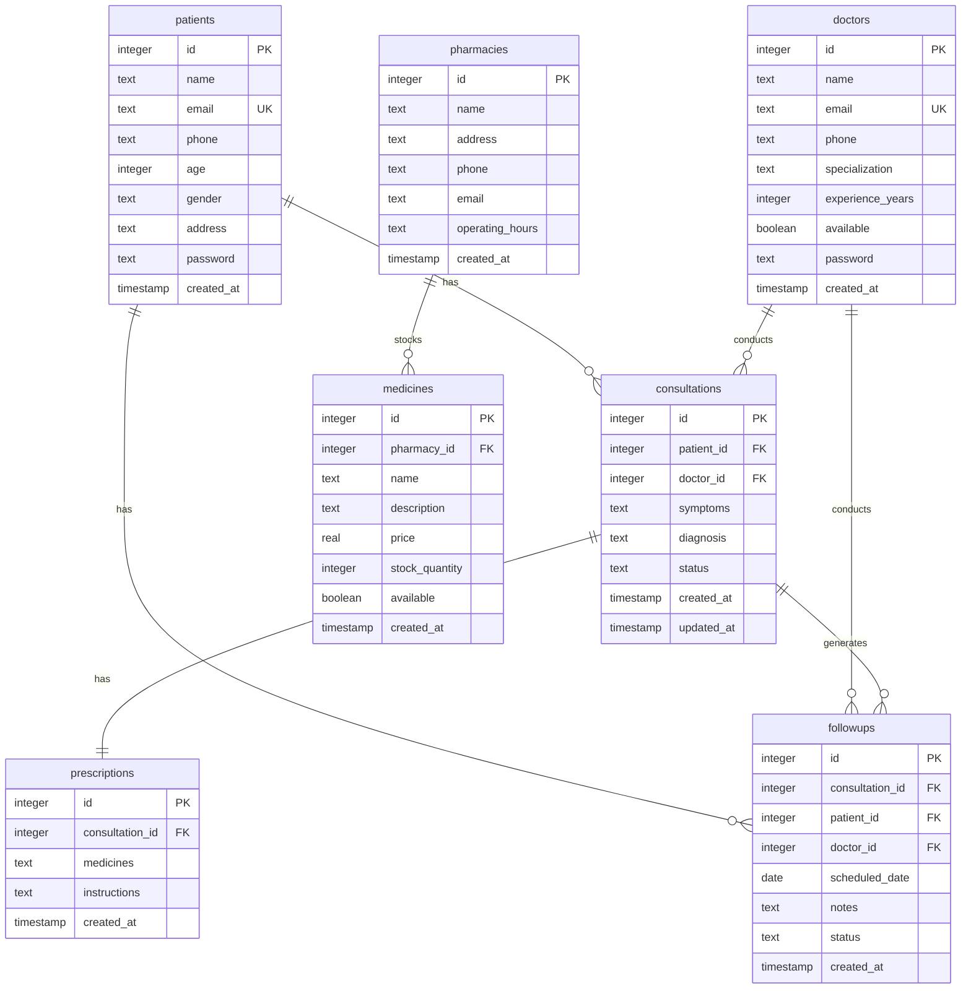

# Telemedicine Platform - Entity Relationship Diagram

## Database Schema Overview

```
┌─────────────────┐
│    patients     │
├─────────────────┤
│ id (PK)         │
│ name            │
│ email (UNIQUE)  │
│ phone           │
│ age             │
│ gender          │
│ address         │
│ password        │
│ created_at      │
└────────┬────────┘
         │
         │ 1
         │
         │ N
         │
┌────────▼────────┐         ┌─────────────────┐
│ consultations   │         │    doctors      │
├─────────────────┤         ├─────────────────┤
│ id (PK)         │◄────────│ id (PK)         │
│ patient_id (FK) │         │ name            │
│ doctor_id (FK)  │         │ email (UNIQUE)  │
│ symptoms        │         │ phone           │
│ diagnosis       │         │ specialization  │
│ status          │         │ experience_years│
│ created_at      │         │ available       │
│ updated_at      │         │ password        │
└────────┬────────┘         │ created_at      │
         │                  └─────────────────┘
         │ 1
         │
         │ N
         │
┌────────▼────────┐
│ prescriptions   │
├─────────────────┤
│ id (PK)         │
│ consultation_id │
│ medicines       │
│ instructions    │
│ created_at      │
└─────────────────┘

┌─────────────────┐         ┌─────────────────┐
│   pharmacies    │         │    medicines     │
├─────────────────┤         ├─────────────────┤
│ id (PK)         │◄────────│ id (PK)         │
│ name            │         │ pharmacy_id (FK)│
│ address         │         │ name            │
│ phone           │         │ description     │
│ email           │         │ price           │
│ operating_hours │         │ stock_quantity  │
│ created_at      │         │ available       │
└─────────────────┘         │ created_at      │
                             └─────────────────┘

┌─────────────────┐
│    followups    │
├─────────────────┤
│ id (PK)         │
│ consultation_id │◄───────┐
│ patient_id (FK) │        │
│ doctor_id (FK)  │        │
│ scheduled_date  │        │
│ notes           │        │
│ status          │        │
│ created_at      │        │
└─────────────────┘        │
                            │
                   (FK to   │
                   consultations)
```

## Table Relationships

### 1. patients
- **Primary Key**: id
- **Relationships**:
  - One patient can have many consultations (1:N)
  - One patient can have many follow-ups (1:N)

### 2. doctors
- **Primary Key**: id
- **Relationships**:
  - One doctor can have many consultations (1:N)
  - One doctor can have many follow-ups (1:N)

### 3. consultations
- **Primary Key**: id
- **Foreign Keys**:
  - patient_id → patients(id)
  - doctor_id → doctors(id)
- **Relationships**:
  - One consultation can have one prescription (1:1)
  - One consultation can have many follow-ups (1:N)

### 4. prescriptions
- **Primary Key**: id
- **Foreign Key**: consultation_id → consultations(id)
- **Relationships**:
  - Belongs to one consultation (N:1)

### 5. pharmacies
- **Primary Key**: id
- **Relationships**:
  - One pharmacy can have many medicines (1:N)

### 6. medicines
- **Primary Key**: id
- **Foreign Key**: pharmacy_id → pharmacies(id)
- **Relationships**:
  - Belongs to one pharmacy (N:1)

### 7. followups
- **Primary Key**: id
- **Foreign Keys**:
  - consultation_id → consultations(id)
  - patient_id → patients(id)
  - doctor_id → doctors(id)
- **Relationships**:
  - Belongs to one consultation (N:1)
  - Belongs to one patient (N:1)
  - Belongs to one doctor (N:1)

## Entity Attributes

### patients
| Field | Type | Constraints |
|-------|------|-------------|
| id | INTEGER | PRIMARY KEY, AUTOINCREMENT |
| name | TEXT | NOT NULL |
| email | TEXT | UNIQUE, NOT NULL |
| phone | TEXT | NOT NULL |
| age | INTEGER | NOT NULL |
| gender | TEXT | NOT NULL |
| address | TEXT | - |
| password | TEXT | NOT NULL |
| created_at | TIMESTAMP | DEFAULT CURRENT_TIMESTAMP |

### doctors
| Field | Type | Constraints |
|-------|------|-------------|
| id | INTEGER | PRIMARY KEY, AUTOINCREMENT |
| name | TEXT | NOT NULL |
| email | TEXT | UNIQUE, NOT NULL |
| phone | TEXT | NOT NULL |
| specialization | TEXT | NOT NULL |
| experience_years | INTEGER | - |
| available | BOOLEAN | DEFAULT 1 |
| password | TEXT | NOT NULL |
| created_at | TIMESTAMP | DEFAULT CURRENT_TIMESTAMP |

### pharmacies
| Field | Type | Constraints |
|-------|------|-------------|
| id | INTEGER | PRIMARY KEY, AUTOINCREMENT |
| name | TEXT | NOT NULL |
| address | TEXT | NOT NULL |
| phone | TEXT | NOT NULL |
| email | TEXT | - |
| operating_hours | TEXT | - |
| created_at | TIMESTAMP | DEFAULT CURRENT_TIMESTAMP |

### medicines
| Field | Type | Constraints |
|-------|------|-------------|
| id | INTEGER | PRIMARY KEY, AUTOINCREMENT |
| pharmacy_id | INTEGER | FOREIGN KEY, NOT NULL |
| name | TEXT | NOT NULL |
| description | TEXT | - |
| price | REAL | NOT NULL |
| stock_quantity | INTEGER | DEFAULT 0 |
| available | BOOLEAN | DEFAULT 1 |
| created_at | TIMESTAMP | DEFAULT CURRENT_TIMESTAMP |

### consultations
| Field | Type | Constraints |
|-------|------|-------------|
| id | INTEGER | PRIMARY KEY, AUTOINCREMENT |
| patient_id | INTEGER | FOREIGN KEY, NOT NULL |
| doctor_id | INTEGER | FOREIGN KEY, NOT NULL |
| symptoms | TEXT | NOT NULL |
| diagnosis | TEXT | - |
| status | TEXT | DEFAULT 'pending' |
| created_at | TIMESTAMP | DEFAULT CURRENT_TIMESTAMP |
| updated_at | TIMESTAMP | DEFAULT CURRENT_TIMESTAMP |

### prescriptions
| Field | Type | Constraints |
|-------|------|-------------|
| id | INTEGER | PRIMARY KEY, AUTOINCREMENT |
| consultation_id | INTEGER | FOREIGN KEY, NOT NULL |
| medicines | TEXT | NOT NULL |
| instructions | TEXT | - |
| created_at | TIMESTAMP | DEFAULT CURRENT_TIMESTAMP |

### followups
| Field | Type | Constraints |
|-------|------|-------------|
| id | INTEGER | PRIMARY KEY, AUTOINCREMENT |
| consultation_id | INTEGER | FOREIGN KEY, NOT NULL |
| patient_id | INTEGER | FOREIGN KEY, NOT NULL |
| doctor_id | INTEGER | FOREIGN KEY, NOT NULL |
| scheduled_date | DATE | NOT NULL |
| notes | TEXT | - |
| status | TEXT | DEFAULT 'scheduled' |
| created_at | TIMESTAMP | DEFAULT CURRENT_TIMESTAMP |

## Mermaid Diagram



## Data Flow

1. **Patient Registration/Login** → patients table
2. **Consultation Request** → consultations table (links patient and doctor)
3. **Doctor Diagnosis** → consultations table (diagnosis field) + prescriptions table
4. **Follow-up Scheduling** → followups table (links consultation, patient, and doctor)
5. **Medicine Search** → medicines table (joined with pharmacies table)
